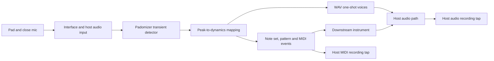

# Padomizer Design and Implementation

Padomizer turns strikes on a close-miked drum practice pad into either WAV one-shots or pitched MIDI notes. It uses the timing and level of the input transient to preserve the performance. In MIDI mode, the note set and pattern determine the pitch, while a downstream instrument determines the sound. The primary design priority is accurate detection of quiet strokes, fast doubles, and accents at low monitoring latency.

This reference covers the Windows x64 VST3 built from the current source and the accompanying REAPER workflows. The original hardware setup is a Samson Q2U over XLR into an M-Audio M-Track Solo running the manufacturer's ASIO driver, with the mic close to a gum-rubber Real Feel pad and interface gain kept low. Other input chains change the level and shape of the captured transient. [Quick start and build entry points](README.md)

## Signal flow and ownership



| Layer | Contract | Implementation |
| --- | --- | --- |
| VST3 wrapper | Audio effect with one main input and output, each independently mono or stereo. Advertises MIDI input and output. | [CMake target](CMakeLists.txt), [processor declaration](Source/PadTrigger.h) |
| Audio callback | Reads mic samples and supported MIDI Learn events. Chooses calibration or strike processing, advances MIDI deadlines, renders WAV voices when applicable, and publishes telemetry. | [PadTrigger.cpp](Source/PadTrigger.cpp) |
| Strike detection | Maintains attack and level history per input channel and emits one peak event for a detected stroke. | [StrokeDetector.h](Source/StrokeDetector.h) |
| MIDI generation | Owns note sets, pattern slots, random selection, channel 1 note events, and pitch wheel messages. | [MidiNotes.cpp](Source/MidiNotes.cpp) |
| Modulation | One LFO with an independent amount for each destination. The processor decides when to evaluate each destination. | [Lfo.h](Source/Lfo.h), [PadTrigger.cpp](Source/PadTrigger.cpp) |
| Front panel | Hardware-style rotary controls, waveform and note readouts, and an inline note-set keyboard. | [PadEditor.cpp](Source/PadEditor.cpp), [PoolEditor.cpp](Source/PoolEditor.cpp) |
| Recording and playback | The host chooses the recording tap, creates media items, routes MIDI and audio, and runs external instruments. | [REAPER templates and routing](#reaper-recording-and-playback) |

In **WAV Sample** mode, the output is rendered sample audio. In **MIDI Notes** mode, the audio output buffer is cleared and note events carry their positions within the host block. At the start of each block, Padomizer optionally reads incoming note-ons for Track MIDI Learn and then clears the supplied MIDI buffer. Put the receiving synth downstream. Route unrelated controller performance MIDI around Padomizer if it must reach the synth. A switch out of MIDI mode can emit note-offs and a center pitch wheel message to release previously generated notes. [Audio and MIDI callback](Source/PadTrigger.cpp)

## Calibration and stroke detection

### Calibration

Calibration measures the raw input, with the louder absolute sample selected when both channels are present. Interface gain and mic placement determine the measurement. The plugin's Sensitivity, Dynamics, and output settings can stay at their performance values while measuring.

| Stage | Measurement |
| --- | --- |
| Room noise | Two seconds of 10 ms peak bins, summarized with the 90th percentile in dBFS. |
| Soft taps | Five peaks within a 15 s capture. Stores the median in dBFS. |
| Hard accents | Five peaks within a second 15 s capture. Stores the median and checks the separation from soft taps and room noise. |

Soft and hard capture uses a gate of `max(-116 dBFS, N + 3 dB)`, a quiet threshold of 80% of that linear amplitude, a 20 ms quiet qualification, an 80 ms peak window, and a 220 ms holdoff. The calibration window measures the full attack of an isolated example, including a main impact that follows a quiet first threshold crossing. Live playback still uses its own window of up to 1.5 ms after a qualifying onset. A strong crest that falls outside that live window can affect calibration without affecting a note that has already sounded. Capture and the intervening prompts mute playback and suppress new notes. A stage can be retried if it times out before five peaks. The previous calibration stays active when a weak result is offered for explicit acceptance. A result is weak if soft taps are within 9 dB of noise or the hard-to-soft separation is below 6 dB. Committed levels are packed into an atomic integer at 0.5 dB resolution. [Calibration and level packing](Source/PadTrigger.cpp)

### Performance detector

The calibrated trigger threshold in dBFS is

```text
gateDb = clamp(max(N + 3, min(S, H) - 6) - Sensitivity, -116, 0)
```

An uncalibrated instance uses −74 dBFS before applying Sensitivity. Increasing Sensitivity lowers the trigger threshold. After conversion to linear amplitude, the rearm threshold is bounded between 45% and 85% of the trigger gate using the calibrated noise floor plus 1.5 dB. [Threshold calculation](Source/PadTrigger.cpp)

1. **Extract attack evidence.** Each input channel carries a first-order 100 Hz high-pass state for attack novelty. Short onset and level envelopes decay with 1.8 ms and 8 ms time constants. The detector compares current evidence with a history approximately 0.65 ms old. Two channels are evaluated separately, and the louder qualifying channel supplies the peak.
2. **Confirm the crossing.** The raw level must cross the gate on the same channel as the attack evidence. A near-threshold attack can arm a roughly 0.55 ms crossing window after the detector has rearmed. This helps catch a quieter stroke whose crest follows the initial edge.
3. **Suppress ringing.** A channel normally rearms after about 4.5 ms below the quiet threshold. At rearm, the attack history is initialized from the quiet signal. While the pad is still ringing, the detector measures the waveform change across about 0.167 ms of input history and compares it with a gate-derived threshold and the recent edge envelope. That change must also exceed 1.15 times the residual peak from the preceding samples and two completed 3 ms windows. This rises to 1.35 times when the residual exceeds 16 times the gate. The detector uses past samples for these comparisons. Retrigger adds a separate, sample-counted cooldown that starts at the accepted onset.
4. **Report the hit.** The detector measures the selected channel over a 1.5 ms window including the onset sample. It emits early if the peak reaches the top of the response range. A fixed MIDI velocity of 127, with no floor modulation, allows emission at the gate crossing. An isolated quiet hit accepted at sample 0 of its window emits at sample 71 at 48 kHz if the entire window is needed. [Detector implementation](Source/StrokeDetector.h), [callback integration](Source/PadTrigger.cpp)

The detector carries its state across host blocks. There is no plugin-reported lookahead or latency compensation. Trigger delay still includes any time it takes for the strike to meet the onset and gate conditions, plus the peak decision window. Live round-trip latency also depends on converter, driver, host buffers, routing, and the instrument or downstream FX. Retrigger is measured from accepted onsets and is independent of MIDI Note Length. At the default 50 ms it limits new accepted onsets to roughly 20 per second, even with a short Note Length. [Block-boundary timing tests](Tests/PadTriggerTests.cpp)

The trigger criteria are shared by both output modes. Any sound with sufficient level and the right transient characteristics can qualify. This build has no learned pad classifier. A second stroke whose attack remains buried in the first stroke's ring can be missed even when the Retrigger cooldown has elapsed.

### Dynamics mapping

Let `S` and `H` be the calibrated tap and accent medians, and `P` the detected peak in dBFS. The response is:

```text
range = max(3 dB, abs(H - S))
floor = (S + H - range) / 2
strength = clamp((P - floor) / range, 0, 1)
response = strength ^ Dynamics

WAV voice amplitude = 0.08 + 0.92 * response
MIDI velocity = round(VelFloor + (127 - VelFloor) * response)
```

Dynamics above 1 increases the contrast by reducing intermediate amplitudes or velocities. Dynamics below 1 brings intermediate hits closer to accents. Accents follow the same continuous response curve as other strokes. Instrument patches can map velocity to level, envelopes, sample layers, filter cutoff, or other parameters, so MIDI velocity has no fixed acoustic gain curve. WAV Output changes the one-shot mix after voice gain. [Response and rendering](Source/PadTrigger.cpp)

## WAV playback

The loader accepts mono or stereo WAV files up to 10 seconds. The source sample rate must be finite and between 1 and 384 kHz. The processor reports a conservative tail of `10 × 2^(25/12)` seconds, about 42.4 seconds, to cover the slowest permitted playback rate. The file is decoded into a float buffer and non-finite samples are replaced with zero. A successful replacement is published at a block boundary in WAV mode. A failed manual load leaves the current sample in use. A missing path restored from project state is displayed as missing or unreadable. [WAV loader and handoff](Source/PadTrigger.cpp)

- **Voice engine.** One hit starts one voice at source frame zero. A 32-slot ring selects the next voice and overwrites that slot if it is still active. Active voices sum in floating point. Mono media feeds both outputs, and mono output averages the rendered left and right. No limiter or peak normalization is applied, so overlapping voices can exceed full scale.
- **Pitch.** The linear interpolator advances the source position by `sourceRate / hostRate * 2^((round(semitones) + cents/100)/12)`. Pitch and sample duration follow the playback rate. When modulated, the pitch change applies to active voices as well as new ones. Linear interpolation and the absence of a dedicated anti-alias filter are relevant at high-speed transpositions.
- **Output gain.** The mix is multiplied by the shared Output gain with a 12 ms smoothing time. Individual voice amplitude is set at trigger time. A sample replacement clears active voices. [Voice mixer](Source/PadTrigger.cpp)

## MIDI notes, sets, and patterns

A new instance starts in MIDI Notes with a one-octave C major pentatonic pool and Wandering motion. The legacy factory sets include C Major Pentatonic, A Minor Pentatonic, D Dorian, G Mixolydian, C Major Arpeggio, and A Minor Arpeggio. A set stores unique MIDI pitches from 0 to 127. The 12-key inline keyboard edits the currently selected octave, and the octave selector exposes the full MIDI range. Padomizer labels MIDI 60 as C4. Track MIDI Learn accepts positive-velocity note-ons from the host event buffer. Direct-device learning opens the selected MIDI input through JUCE on the editor side. Both routes collect pitches for inclusion in the set. [Factory sets and parsing](Source/MidiNotes.cpp), [note-set controls](Source/PoolEditor.cpp)

Edits change the active pitch pool after the next audio-side state handoff. Removing a pitch clears every pattern slot holding that base pitch and retains the other slots. **Save** names the working set, **New** starts with an empty working set, and **Revert** reloads the selected set. Factory presets stay available under their original names. With an empty active set the detector can show hits without producing notes. A one-pitch set repeats that note. Transposition is applied after selecting the base pitch, so a disabled base pitch can still be heard if another pitch is transposed to it. [Active pool and pattern invalidation](Source/MidiNotes.cpp)

| Playback mode | Slot and pitch behavior |
| --- | --- |
| **0 Free** | Pick a new pitch on each hit. Where at least two choices exist, exclude the previous base pitch. |
| **1–16 with regular advancement** | Fill the first empty slot on successive hits, then cycle from the first slot. When learning the final slot with at least three pool pitches, avoid the first pitch as well as the previous pitch. |
| **1–16 with Pattern Position depth** | Read the addressed slot on each hit. Generate its pitch only if it is empty. Skipped slots stay empty. Visiting an occupied slot reuses its base pitch, even on successive hits. |

Explore keeps a bounded history of eight MIDI onsets with base pitch, output pitch, and velocity. Keep copies the selected 1–8 base pitches, resets the cursor, and saves the phrase in project state. A cell edit changes one pitch. The single undo entry retains its previous value. Key and register transpose generated scales and saved sets. Changing scale remaps kept pitches to nearby allowed notes.

Steady favors the current pitch. Wandering favors close intervals. Leaps weights larger distances. Legacy random avoids immediate repeats where the set allows. Follow chords tracks held MIDI pitches by channel and uses their pitch classes when choosing new pitches, with the configured scale or set as fallback. Track MIDI Learn takes precedence. Tempo gates calculate the note-off deadline from the BPM at onset. Audition sends a fixed MIDI note without changing the phrase history or cursor.

The pattern stores base pitches. Each strike still receives fresh velocity and a newly evaluated Note Length and transpose. Changing the base length or active named set clears the loop. LFO modulation of length changes the visible prefix without erasing the slots outside it. **Reset Pattern** clears all slots. Pattern Position and Pattern Length can run together. The hit resolves length first, then computes the addressed slot within that length. Recall preserves generated slots, including gaps, and starts the ordinary step cursor at the beginning. The live cursor and random generator state are transient. [Pattern state and playback](Source/MidiNotes.cpp), [modulation application](Source/PadTrigger.cpp)

MIDI output uses channel 1. Each note-off is scheduled in sample frames at note-on time. A retrigger of the same emitted pitch sends note-off before note-on at that same frame and replaces the old deadline. Different pitches can overlap. A mode change away from MIDI, calibration muting, or audio restart releases pending notes as the callback resumes. **Semitones** is rounded and added to each new base pitch, then the result is limited to MIDI 0–127. **Cents** sends 14-bit channel pitch bend centered at 8192. Each generated note establishes its wheel value before note-on, including a centered wheel, so a take can begin between hits. Set **MIDI Bend Range** to match the instrument's own range. With overlapping notes, pitch bend affects the whole channel. [Note scheduling and pitch wheel](Source/MidiNotes.cpp)

## LFO and host parameters

The LFO has Sine, Triangle, Ramp Up, Ramp Down, Square, Pulse, and 4 Steps shapes. All assigned destinations share the same waveform and phase. A choice in **Target** selects the Depth control being edited, and each destination retains its own Depth parameter.

- **Seconds.** The oscillator advances from its internal sample clock from 0.025 to 120 seconds per cycle. Audio preparation resets the phase.
- **Tempo.** The interval is one to four bars or a straight, dotted, or triplet duration from a half note through a thirty-second note. Bar divisions use the host time signature. During playback, valid host PPQ anchors phase at the start of each block. While stopped or without PPQ, the phase continues from the cached tempo and meter. Audio preparation initializes the fallback to 120 BPM and 4/4.
- **Ordinary depth.** A percentage scales half of the target's numeric span. The bipolar waveform offsets the base value, then the result clamps to the destination bounds. Semitones and Cents use physical units of ±24 st and ±100 ct at maximum depth. Pattern Length has a special base value of 0 that always stays Free.
- **Pattern Position depth.** For effective length `L` and positive depth `D` in percent, the number of reachable slots is `1 + round((L - 1) * D / 100)`. The bipolar waveform is mapped into equal-width slot bins across that prefix. At 100%, Ramp Up scans the whole loop in order. Slots advance with the LFO phase, and MIDI notes only appear when a hit arrives. Zero depth restores ordinary step advancement.
- **Evaluation timing.** Sensitivity, WAV Output, and WAV pitch follow a 16-sample control grid aligned to the sample clock. Retrigger evaluates at the accepted onset. MIDI note velocity, length, transpose, loop length, and addressed step evaluate when the detector emits the peak. With Cents modulation, the processor evaluates bend at hits and on an approximately 2 ms grid during held notes, and transmits a pitch wheel event only when the quantized wheel value changes. [Waveforms and depth mappings](Source/Lfo.h), [clock and control timing](Source/PadTrigger.cpp)

| Host parameter ID | Range and default | LFO depth ID |
| --- | --- | --- |
| `soundMode` | WAV Sample or MIDI Notes. Default WAV Sample. | — |
| `sensitivity` | −12 to +12 dB, 0.5 dB steps, default 0 dB | `lfoSensitivity` |
| `dynamics` | 0.35 to 2.75, 0.01 steps, default 1.00 | `lfoDynamics` |
| `sampleGain` | −48 to +6 dB, 0.5 dB steps, default −6 dB | `lfoOutput` |
| `retriggerMs` | 8 to 120 ms, default 50 ms | `lfoRetrigger` |
| `velocityFloor` | 1 to 127, default 72 | `lfoVelocity` |
| `patternLength` | 0 to 16, default 0 Free | `lfoPattern` |
| `noteLengthMs` | 10 to 1000 ms, default 140 ms | `lfoNoteLength` |
| `pitchSemitones` | −24 to +24 st, default 0 st | `lfoSemitones` |
| `pitchCents` | −100 to +100 ct, default 0 ct | `lfoCents` |
| `bendRange` | 1 to 48 st in either direction, default ±2 st | — |
| Pattern Position | Derived from phase and effective pattern length | `lfoPatternPosition` |
| `lfoShape`, `lfoClock` | Default Sine and Seconds | — |
| `lfoSeconds`, `lfoDivision` | Default 2.000 s and 1/4 note | — |

All depth values default to zero. Keep the parameter IDs stable when changing labels or UI. The processor snapshots parameter values per callback. Its internal LFO can evaluate more precisely inside that block than the snapshot used for host parameter changes. [JUCE parameter layout](Source/PadTrigger.cpp)

## Editor, telemetry, and state

The compact editor is a 760 × 450 faceplate. The phrase display shows recent or retained pitches, velocities, and the last and next steps. The signal strip shows mic activity, confirmed hits, MIDI activity, and notes per second. Input Setup, Modulation, and Note Editor expand inside the case. **MIC IN** shows the min/max envelope, dBFS peak, clipping, gate lines, and hit markers. **SAMPLE OUT** shows the WAV waveform. **Scan phrase** highlights the LFO-addressed step. [Front panel and scope drawing](Source/PadEditor.cpp)

The callback publishes roughly 2 ms min/max buckets in a 1024-entry atomic ring. The editor copies the latest 256 entries, corresponding to about 512 ms, on a 30 Hz timer. Each packed entry carries the input and output extrema, flags for gate crossings and hits, and a rejection reason where available. A hit marker takes precedence within the same bucket. The short markers indicate a near-threshold onset that failed to cross, a new edge during Retrigger, or a gate crossing without sufficient attack evidence. These are signal diagnostics rather than a count of physical misses. The graphics thread maintains peak and clip hold times independently of detection. [Scope publication](Source/PadTrigger.cpp)

| State | Persistence and ownership |
| --- | --- |
| Parameters | JUCE `AudioProcessorValueTreeState` serialized as XML in the host state blob. |
| Calibration | Packed room, soft and hard levels plus a calibrated flag. |
| Sample | Absolute path. Projects moved to another system can require relinking. |
| Pitch sets and pattern | Selected set index, custom sets, optional working selection, key, scale, register, motion, chord-follow mode, phrase mode, base length, and base pitches. Interior empty slots are stored as `-`. |
| Runtime | Detector history, active voices and deadlines, cursor, random generator state, LFO phase, and UI meters exist only while processing. |

The processor preserves its `PadTrigger` state root and the legacy VST3 identity. Restore supplies defaults for missing newer parameters and drops the obsolete Auto Retrigger parameter. Used or pending sample buffers are exchanged through a short spin-lock handoff, with the callback trying once and keeping the current buffer if the publisher is busy. UI-side pool mutations publish a revision with a fixed-size notes and pattern snapshot. The callback uses try-locks to consume it and to publish learned changes. A revision guard prevents an older callback snapshot from overwriting a newer UI mutation. Project restore publishes MIDI slots and their base length as a coordinated update. The callback keeps its previous pattern and length if either handoff is busy. MIDI buffer growth and host wrapper behavior are separate considerations when profiling real-time allocation. [Processor state and sample handoff](Source/PadTrigger.cpp), [pool and pattern handoff](Source/MidiNotes.cpp)

## REAPER recording and playback

The record tap determines the media item. A flat audio item can be a valid capture of the low-level mic if the track is set to record its input and Padomizer and the synth are in regular FX. The track can monitor the generated sound while writing that dry mic item. Putting regular Padomizer FX on a track that already contains rendered audio can also retrigger from the item's transients when it plays. The scopes show the plugin's incoming and outgoing signals and cannot identify what the host wrote. [REAPER User Guide](https://dlx.reaper.fm/userguide/html/)

| Goal | FX placement | Record tap and playback |
| --- | --- | --- |
| Editable MIDI on one track | Padomizer in **Input FX** in MIDI Notes mode. ReaSynth or the chosen instrument in regular **FX**. | **Record output MIDI**, pre-FX. REAPER captures after Input FX and before the regular instrument. The MIDI item plays through that same regular instrument. |
| Stereo instrument print on one track | Padomizer followed by ReaSynth or another compatible instrument, both in **Input FX**. | **Record stereo output**, latency compensated, post-FX/pre-fader. The recorded WAV plays through the regular track path. |
| Built-in WAV one-shot on one track | Padomizer in **Input FX** in WAV Sample mode. | **Record input** captures the processed input. Mono hardware input can produce a mono take. Use a stereo output tap when preserving a stereo sample image is required. |
| Separate stereo print track | Padomizer and, in MIDI mode, a downstream instrument in regular FX on a mic track. Audio-only post-FX/pre-fader send to the print track. | Mic track monitors only. The print track records its latency-compensated stereo output post-FX/pre-fader and plays back the WAV. |

The single-track MIDI template uses mono Input 1, tape-style monitoring, and a disarmed track. It uses `I_RECMODE=4` and `I_RECMODE_FLAGS=1`. The stereo template uses `I_RECMODE=3` and `I_RECMODE_FLAGS=2`. For an alternate hardware input, change the input selection in REAPER and calibrate that signal chain. The native Record and Stop buttons are sufficient after loading either template. [MIDI template](Padomizer%20-%20One-track%20MIDI.RTrackTemplate), [stereo template](PadTrigger%20-%20One-track%20stereo.RTrackTemplate), [REAPER track attributes](https://www.reaper.fm/sdk/reascript/reascripthelp.html#GetMediaTrackInfo_Value)

The separate print script checks for a mono audio input, enabled regular FX, and an empty source track. In MIDI mode it requires an enabled downstream instrument. It can adopt a single matching stereo receive from an imported template and stores the live source GUID in `P_EXT:PadTriggerSource`. It disables the source's master send to prevent duplicate monitoring and preserves adopted send gain. The recording action starts REAPER transport after setup. The setup action uses the same routing logic with transport stopped. [Record audio](REAPER/PadTrigger%20-%20Record%20audio.lua), [Set up stereo print](REAPER/PadTrigger%20-%20Set%20up%20stereo%20print.lua), [two-track template](PadTrigger%20-%20sforzando%20Stereo%20Print.RTrackTemplate)

## Build, verification, and review

Build with CMake 3.22 or later, Git, and Visual Studio 2022 with the Desktop development with C++ workload. The CMake target is `PadTrigger_VST3`. The host displays **Padomizer** and the bundle remains `Pad Trigger.vst3`. The manufacturer and plugin codes are `Myvs` and `Pdtr`. Supply a local JUCE checkout through `JUCE_SOURCE_DIR` or let CMake fetch the pinned commit. If REAPER scans both per-user and system-wide VST3 locations, compare their binaries when an older interface or behavior keeps appearing. The plugin identity is identical between builds that use the same class ID. [Build setup and pinned dependency](CMakeLists.txt)

```powershell
cmake -S . -B build -G "Visual Studio 17 2022" -A x64 -DPADTRIGGER_BUILD_TESTS=ON
cmake --build build --config Release --target PadTrigger_VST3 PadTriggerTests
ctest --test-dir build -C Release --output-on-failure
```

The CTest entry runs a signal-level harness around the real processor. It synthesizes low-level noise, transients, and resonant tails, and uses a generated WAV fixture. Covered cases include low-gain calibration, same-channel onset verification, hard-hit ringing, fast doubles, note-off and retrigger behavior, pitch bend, per-hit LFO evaluation, sparse pattern recall, immediate note-set edits, WAV replacement and resampling, and front-panel checks. The latency regression checks 44.1, 48, and 96 kHz at 32, 128, and 1024 samples per block, with events placed at block edges. The tests exercise processor event timing and host-reported latency. Physical miss rates and end-to-end ASIO monitoring latency require hardware measurements. [Test harness](Tests/PadTriggerTests.cpp)

During development, a native REAPER 7.86 smoke test at 48 kHz with a 128-sample ASIO buffer injected four synthetic strokes into Input FX. The pre-FX MIDI tap recorded four notes and the test pitch bend. A second test imported the saved template, recorded four editable notes, and played the item back through ReaSynth and Vital. This checked the host recording route and instrument playback. The timing and false-trigger tests for the physical pad are separate review cases below.

A separate REAPER run started a take after warm-up with Cents at +50 and moved the recorded item to a fresh ReaSynth instance. In the render, the first note measured 50 cents above the centered control rendered from the same item.

An isolated REAPER 7.86 offline render used a generated 10-second stereo decay at −24 semitones and −100 cents, with different frequencies and a delayed entry on the right channel. With a 42.4-second render tail configured in REAPER, the WAV preserved both channels and the decay continued for about 42.38 seconds after the strike. Both channels matched a sample-by-sample reference within the rounding error of the 16-bit export. Set the render tail in REAPER to suit the sample and pitch when using time bounds that end shortly after the last strike.

The optional Release callback benchmark times 12,000 blocks per case for idle WAV, one voice, dense WAV playback, and modulated MIDI at 48 and 96 kHz with 32, 64, and 128 frames. Its editor cases paint the faceplate concurrently in the test process. In the development run the highest p99 was about 3.5% of its block budget, with no overruns across 576,000 measured blocks. The generated MIDI occupied at most 36 bytes per block against the pinned JUCE VST3 wrapper's 2,048-byte reserve. The benchmark isolates processor time and excludes the DAW audio graph, incoming MIDI bursts, wrapper allocations, and device scheduling.

The release-pass smoke tests reproduced a take that captured four notes and zero bend events after a monitored warm-up at +50 cents. With the rebuilt VST3, the same setup recorded four notes and four bend events, including the expected value at the first note. REAPER also recorded a two-channel, non-silent WAV from the neutral ReaSynth stereo template and six MIDI 36 notes from the fixed-note preset. The separate print action reused both imported print pairs without adding tracks or sends.

| Review focus | Reproduction and evidence |
| --- | --- |
| Trigger accuracy | Use synchronized reference strikes and raw mic captures for soft taps, accents, and rolls across several mic gains. Count missed hits, double triggers, and false triggers separately. Include isolated non-pad knocks and loud playback. Preserve input sample offsets when comparing MIDI output. |
| Latency | Measure accepted onset to output event in frames, then measure physical strike to monitored output with a separate reference channel. Record sample rate, interface buffer, REAPER routing, and receiving instrument. Report the distribution as well as worst cases. |
| Sound design | Compare velocity against calibrated input dBFS with multiple synth patches. Check pitch-wheel scaling, overlapping notes, and filter or layer changes driven by velocity. In WAV mode inspect the output peak and headroom with dense overlaps and pitch sweeps. |
| Host routing | On a fresh track, verify Record and Stop create the expected MIDI or WAV item. Check first-hit timing, take replay, input monitoring while recording, overdub behavior, and pitch-wheel capture. Run equivalent checks per host before claiming general DAW support. |
| Concurrency and recall | Change note sets and samples during processing, save and reopen, and compare pattern slots, disabled notes, parameters, and sample-path behavior. Exercise older projects before changing parameter IDs or the serialized state layout. |

For human and AI reviews, start at `PadTrigger::processBlock` and follow the branch for the relevant mode. Read the production detector or MIDI engine alongside the closest regression test. For a finding, record the code symbol or template, the input and parameter assumptions, the observed output, and the smallest case that reproduces it. Preserve the distinction among gate crossings, accepted detector hits, emitted note-ons, and media written by REAPER. Those events can diverge for an empty set, a missing sample, an overlapping stroke, or a different recording tap.
